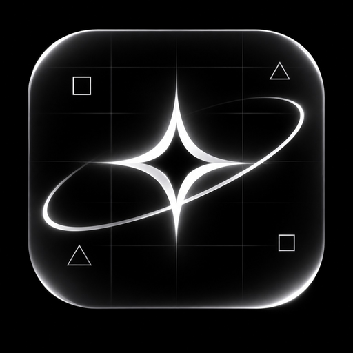

<p align="center">
  
</p>

<h1 align="center">FlexTounch</h1>
<p align="center"><b>Make every touch come alive.</b><br/>
A minimal black-and-white touch playground for Android, led by a four-point Nova and glass-outline geometry.</p>

---

## FlexTounch v0.5 — Nova Motion Update

The default experience is monochrome: a near-black canvas, a fine white grid and a four-point Nova. The live wallpaper uses the same black grid. Optional square/triangle particles can be switched off independently.

## v0.5 rendering updates

- Rebuilt Nova as a clean four-point optical star with two asymmetric Bezier orbital ribbons.
- Cached reusable paths and paints in the Nova renderer; removed per-frame Paint/Path construction from its geometry pass.
- Playground and live-wallpaper drag samples are interpolated at tighter spacing to reduce dotted gaps during fast movement.
- Grid paint is retained instead of allocated on every draw in the playground and live wallpaper.

## Features

| | |
|---|---|
| **Water** | Ripples on a tilted water plane: refractive lens, dark trough, bright crest, glossy droplets |
| **Orbs** | Burst of shaded 3D beads (diffuse + rim light + specular) with a glassy bubble pop |
| **Lightning** | Forked, flickering bolts (midpoint displacement), glow/halo/core layers, corona and sparks |
| **Nova** | Four-point star, rotating orbital ribbons, bright core, shock ring and trailing sparks |
| **Glass geometry** | Optional outlined squares and triangles with a subtle extruded edge and falling motion |
| **Surprise me** | Picks a random effect on every tap |
| **Colour** | Monochrome is the default; optional accent palettes remain available |
| **Fine-tuning** | Size, duration, intensity, haptic tick, drag trails and geometry toggle |
| **Multi-touch** | Every finger gets its own effect |
| **Three ways to use it** | In-app playground · Live wallpaper · All apps (accessibility overlay) |
| **Private by design** | Only permission is `VIBRATE`. No internet, no analytics, zero third-party libraries |

## Where the effects show up

1. **Playground** – the top of the app. Taps and drags, with live preview of every setting.
2. **Live wallpaper** – effects on the home screen. Works on every Android version, no special access.
3. **All apps** – an accessibility service adds a pass-through overlay above every app. Touches are
   never blocked or modified. It positions the effect using a 1×1 px listener window that Android notifies
   about touches elsewhere on screen; if a device hides those coordinates, it falls back to the centre of the
   clicked view.
   > Sideloaded APKs on Android 13+: if the switch is greyed out, open **App info → ⋮ → Allow restricted settings**.

## Build

Requirements: JDK 17 and the Android SDK (platform 35). Android Studio does all of this for you.

```bash
# Android Studio: File ▸ Open ▸ select this folder ▸ Run ▸
# or from a terminal:
./gradlew assembleDebug          # app/build/outputs/apk/debug/app-debug.apk
./gradlew assembleRelease        # optimised; signed with the debug key so it installs
```

No local setup? Push the folder to GitHub: `.github/workflows/build.yml` builds both APKs and uploads
them as a downloadable artifact.

## Project layout

```
app/src/main/java/com/flextounch/app/
├── MainActivity.kt                    single-screen UI, built in code (no AppCompat/Material)
├── data/Prefs.kt                      SharedPreferences ↔ FxConfig
├── fx/
│   ├── EffectEngine.kt                spawns / updates / draws effects (surface-agnostic)
│   ├── EffectView.kt                  View host: playground + overlay layer
│   ├── Effect.kt                      base class + Spec
│   ├── RippleEffect.kt  OrbEffect.kt  LightningEffect.kt  NovaEffect.kt
│   ├── Sphere.kt                      reusable fake-3D glossy ball
│   └── Colors.kt  Ease.kt  FxConfig.kt  Haptics.kt
└── service/
    ├── FlexTounchWallpaperService.kt   live wallpaper
    ├── FlexTounchAccessibilityService.kt   all-apps overlay
    └── FxState.kt
```

### Add your own effect

1. Create `MyEffect(spec: Spec) : Effect(spec)` and draw in `draw(canvas)` using `t` (0‥1 progress), `s.unit`
   (pixels per design-dp) and `s.color`.
2. Add a value to `EffectType` and a branch in `EffectEngine.spawn`.

Rendering notes: gradients are created once at unit size and scaled by the canvas, so frames allocate almost
nothing; the wallpaper only renders while an effect is alive, so it costs ~0 battery when idle.

## Icon

Adaptive vector icon (`res/drawable/ic_launcher_*.xml`) with a themed monochrome layer for Android 13+.
`art/icon.svg` is the source; `art/icon-512.png` is ready for a store listing.

## Known limitations

- The All-apps mode relies on platform behaviour that differs between OEMs and Android versions; the
  wallpaper and playground are the guaranteed paths. Drag trails are only available in those two, since Android
  reports outside touches only on finger-down.
- Effects are drawn with the Canvas API for maximum compatibility. An AGSL shader path (Android 13+) for true
  refraction would be a natural next step.

## License

MIT
